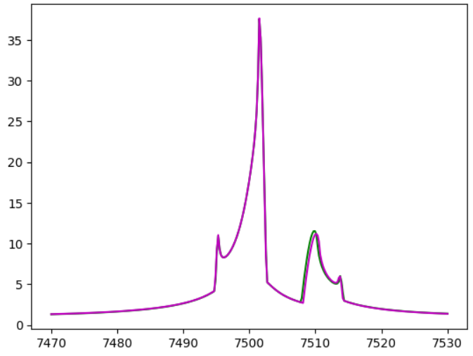
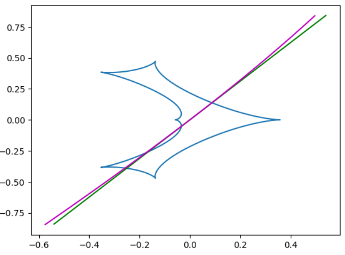
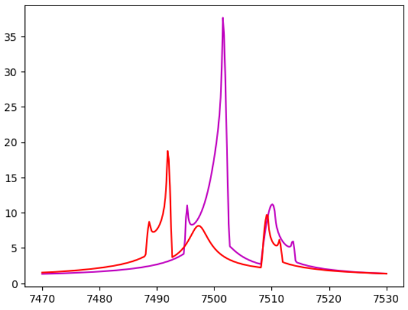
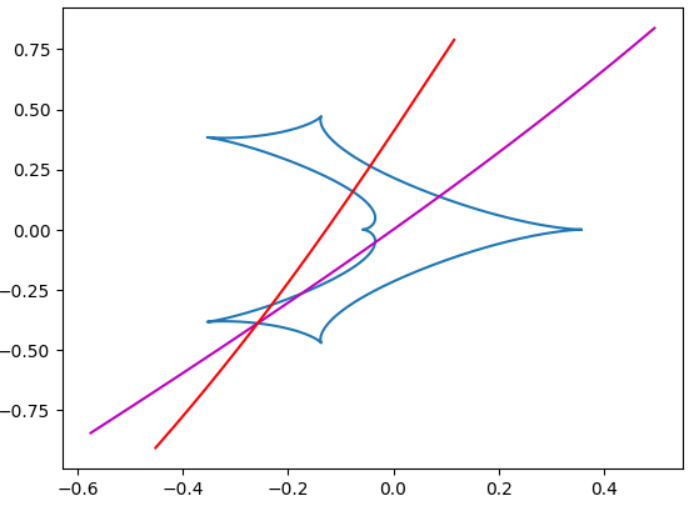

[Back to **Light Curve Functions**](LightCurves.md)

# Parallax

In the basic light curve functions discussed in the [Light Curve Functions](LightCurves.md) section, we assumed that observer, lens and source move rectilinearly. Therefore, the relative lens-source angular motion is rectilinear and described by the two parameters $u_0$ and $\alpha$.

In reality, the observer motion is curvilinear as the Earth orbits the Sun. For satellite observations, the situation is similar, since all spacecraft will describe curved orbits. In this section we will introduce a set of functions similar to the "static" ones discussed before, but including the observer motion.

First we will treat geocentric observations and then we will move to observations from space.

## Target coordinates

We need to specify J2000.0 equatorial coordinates for our microlensing target. This is done by function `SetObjectCoordinates`:

```
VBM.SetObjectCoordinates("17:59:02.3 -29:04:15.2") # Assign RA and Dec to our microlensing event
```
The string given as argument here obviously contains Right Ascension and Declination in standard notations.

## Light curve functions with parallax

All light curve functions defined in the [Light Curves](LightCurves.md) section have their corresponding counterpart including the parallax effect:

```
PSPLLightCurveParallax
ESPLLightCurveParallax
BinaryLightCurveParallax
TripleLightCurveParallax
```

The only difference is that the array of parameters must include two more entries for the components of the parallax vector. Here is a full example demonstrating the use of `BinaryLightCurveParallax`:

```
import VBMicrolensing
import math
import numpy as np
import matplotlib.pyplot as plt

VBM = VBMicrolensing.VBMicrolensing()

s = 0.9       # Separation between the lenses
q = 0.1       # Mass ratio
u0 = 0.0       # Impact parameter with respect to center of mass
alpha = 1.0       # Angle of the source trajectory
rho = 0.01       # Source radius
tE = 30.0      # Einstein time in days
t0 = 7500      # Time of closest approach to center of mass
paiN = 0.3     # North component of the parallax vector
paiE = -0.2     # East component of the parallax vector

# Array of parameters. Note that s, q, rho and tE are in log-scale
pr = [math.log(s), math.log(q), u0, alpha, math.log(rho), math.log(tE), t0, paiN, paiE]

t = np.linspace(t0-tE, t0+tE, 300) # Array of times in BJD_TDB - 2450000

VBM.SetObjectCoordinates("17:59:02.3 -29:04:15.2") # Assign RA and Dec to our microlensing event

magnifications, y1, y2 = VBM.BinaryLightCurve(pr,t)      # Calculation of static binary-lens light curve
magnificationspar, y1par, y2par = VBM.BinaryLightCurveParallax(pr,t)      # Calculation of light curve with parallax

plt.plot(t,magnifications,"g")
plt.plot(t,magnificationspar,"m")
```



The light curve including parallax is in magenta in this plot. 

And here is the corresponding source trajectory
```
caustics = VBM.Caustics(s,q)
for cau in caustics:
    plt.plot(cau[0],cau[1])
plt.plot(y1,y2,"g")
plt.plot(y1par,y2par,"m")
```



In this example we have not set `VBM.t0_par`, which means that $t_{0,par}=t_0$ here.

## Satellite Parallax

VBMicrolensing can calculate the magnification as seen from a spacecraft. In order to do that, it is necessary to have the ephemeris of the satellite in the format given by the [NASA Horizons system](https://ssd.jpl.nasa.gov/horizons/app.html).

In particular, we assume five columns:
- JD
- RA (degrees)
- Dec (degrees)
- Distance from Earth (AU)
- Distance rate change (not really needed but included by default in Horizons).

Examples of valid satellite ephemeris tables are in [/VBMicrolensing/data](/VBMicrolensing/data).

The satellite table(s) should be named "satellite*.txt" (with * replaced by a single character) and placed in a single directory. In order to inform VBMicrolensing of these tables, there is an alternative version of the `VBM.SetObjectCoordinates` function:
```
coordinatefile = "OB151212coordinates.txt"
satellitedir = "/usr/data/satellitetables"
VBM.SetObjectCoordinates(coordinatefile, satellitedir)
```
The first argument is the name of a file containing the coordinates of the event, i.e. a string with RA and Dec as before (this file is for the event [OGLE-2015-BLG-1212](https://ui.adsabs.harvard.edu/abs/2016ApJ...820...79B/abstract)). The second argument is the path to the directory containing the satellite tables. When the `VBM.SetObjectCoordinates` is executed, the satellite tables are pre-loaded so that they are ready for use in any calculations.

If you want the magnification as seen from satellite 1, then just set VBM.satellite to 1 before the parallax calculation.
```
magnificationspar, y1par, y2par = VBM.BinaryLightCurveParallax(pr,t)      # Calculation of light curve with parallax
VBM.satellite = 1
magnificationssat, y1sat, y2sat = VBM.BinaryLightCurveParallax(pr,t)      # Calculation of light curve seen from Spitzer

plt.plot(t,magnificationspar,"m")
plt.plot(t,magnificationssat,"r")
```


The light curve as seen from Spitzer (satellite 1) is in red. And here we have the source trajectories

```
caustics = VBM.Caustics(s,q)
for cau in caustics:
    plt.plot(cau[0],cau[1])
plt.plot(y1par,y2par,"m")
plt.plot(y1sat,y2sat,"r")
```


If you want to return to the ground do not forget to set VBM.satellite back to 0!

Note that a warning message is printed if the input times lie outside the range of the satellite ephemeris table.

The satellite tables give the position of the spacecraft relative to the Earth and are looked up at the input epoch, so they should be generated in the same time scale as your input times (TT for $BJD_{TDB}$). The difference with respect to a table in UT (69 s) is negligible for the slow motion of a spacecraft relative to the Earth.

## Parallax system

By default, the parallax components are expressed in the North-East system $(\pi_{E_,N},\pi_{E,E})$. An alternative possibility is to express the parallax vector in the parallel/orthogonal components to the Earth acceleration direction $(\pi_{E,\parallel},\pi_{E,\perp})$. In VBMicrolensing you have both possibilities by setting `VBM.parallaxsystem` to 1 or 0 respectively. The default value is 1, corresponding to the North-East system.

## Reference time for parallax $t_{0,par}$

The parallax effect is introduced as a deviation of the observer from a frame centered on the Earth at a specific reference time $t_{0,par}$, in such a way that the position and the velocity of the source at time $t=t_{0,par}$ remains fixed as seen from the observer. By default, VBMicrolensing uses $t_{0,par}=t_0$, so that the light curve is unchanged at the time of closest approach to the center of mass of the lens. However, if you want to keep the source position fixed at another time, you can set `VBM.t0_par_fixed = 1` and choose your reference time via `VBM.t0_par`.

Comparing models obtained with different $t_{0,par}$ can be very painful, because the choice of this reference time affects many other parameters. We therefore include a function `t0_from_t0_par` that for a given light curve obtained with some arbitrary $t_{0,par}$ provides the parameters of the equivalent light curve with $t_{0,par} = t_0$. Here is an example of use:

```
import VBMicrolensing
import numpy as np
import matplotlib.pyplot as plt
vbm = VBMicrolensing.VBMicrolensing()

vbm.SetObjectCoordinates("18:00:00 -29:00:00")
vbm.t0_par_fixed = 1     # Enable t0_par different from t_0
vbm.t0_par = 11523.0    # Set t0_par

t0 = 11581.0       # Specify parameters of the light curve
paiN=0.1
paiE=-0.5 
u0=0.1
tE=100.0

ts = np.linspace(t0-100, t0+100, 3000)    # Prepare array of epochs
pars = [u0, np.log(tE), t0, paiN, paiE]   # Prepare array of parameters
results = vbm.PSPLLightCurveParallax(pars, ts)   # Calculate light curve with t0_par different from t_0

# Calculate new parameters to reproduce the same light curve with t0_par = t_0
t0_out, tE_out, u0_out, delta_alpha_out, paiN_out, paiE_out = vbm.t0_from_t0_par(t0, tE, u0, paiN, paiE)

vbm.t0_par_fixed=0  # Set t0_par = t_0
pars2 = [u0_out, np.log(tE_out), t0_out, paiN_out, paiE_out] # Prepare array of parameters
results2 = vbm.PSPLLightCurveParallax(pars2, ts)  # Calculate light curve with t0_par = t_0

# Compare light curves
plt.plot(ts, results[0])
plt.plot(ts, results2[0])
```

The two light curves calculated in different parametrization perfectly overlap.

Note that for more complicated light curves (binary-lens, binary-source, ...) the affected parameters remain the same. The value of `delta_alpha_out` is necessary to correct the angle of the source trajectory. For example, the updated parameters for a binary-lens light curve would be

`pars2 = [np.log(s), np.log(q), u0_out, alpha-delta_alpha_out, np.log(rho), np.log(tE_out), t0_out, paiN_out, paiE_out]`

Note that $s$, $q$ and $\rho$ are unaffected, while all other parameters must change.

## JD vs BJD

When we include parallax, it is important to clarify what the input times are. By default, VBMicrolensing assumes that times are given in $BJD' = BJD_{TDB} - 2450000$, where $BJD_{TDB}$ is the arrival time of the light at the solar-system barycenter, in Barycentric Dynamical Time. This is the standard adopted by current pipelines and by the Roman mission. However, if your epochs are the times of reception at the observer (geocentric $JD_{TDB}$), you should just set `VBM.t_in_BJD = False` before the execution of the light curve function: VBMicrolensing then adds the light travel time from the observer to the barycenter (up to 8.3 minutes) internally. This conversion only accounts for the light travel time; it does not change the time scale, so a JD in UTC is treated as if it were in TDB (the two differ by 69 s at present).

Light curves from before the Roman era are usually tagged in $HJD_{UTC}$ (arrival time at the Sun, in UTC). To convert them, add the offset between TDB and UTC: $BJD_{TDB} = HJD_{UTC} + 69.184$ s for epochs after 2017 January 1 (32.184 s plus the 37 leap seconds accumulated by then; for earlier epochs use the number of leap seconds in force at that date, e.g. 35 s in 2012-2015 and 36 s in 2015-2016, see the IERS Bulletin C). The remaining difference, the light travel time between the Sun and the barycenter, is at most 5 s: it displaces the Earth by $10^{-6}$ au and the trajectory by $5\,\mathrm{s}/t_E$, and can be ignored. A single data set left in $HJD_{UTC}$ can also be modeled as if it were $BJD_{TDB}$: the fitted $t_0$ and $t_{0,par}$ then inherit the 69 s offset and the Earth is displaced by $1.4 \times 10^{-5}$ au (69 s of orbital motion). What should be avoided is mixing conventions within one fit, e.g. ground-based $HJD_{UTC}$ together with Roman $BJD_{TDB}$: the 69 s then act as a relative shift of the trajectory of $69\,\mathrm{s}/t_E$ between the two data sets ($1.3 \times 10^{-5}$ for $t_E = 60$ d, but $8 \times 10^{-4}$ for a one-day event) on top of the $1.4 \times 10^{-5}$ au displacement of the Earth; convert the older data sets instead. Since `t_in_BJD` is an attribute of the VBMicrolensing instance, like `satellite`, it can be set before each light curve call if some data sets are in geocentric JD and others in BJD.

Before v5.7, the reference was the Sun and the input times were $HJD' = HJD_{UTC} - 2450000$ (flag `t_in_HJD`; the old table was tagged in UT). Results obtained with the old convention are reproduced by loading a heliocentric table (see below) and interpreting the input times as $HJD_{UTC}$.

## Implementation of parallax calculations

In order to calculate the parallax effect, we need to track the Earth position relative to the solar-system barycenter, which is the inertial reference with respect to which the lens and the source move uniformly. We have two possibilities in VBMicrolensing: using an ephemeris table from [Horizons](https://ssd.jpl.nasa.gov/horizons/app.html), or calculate the Earth position solving the Kepler equation from [orbital elements and their secular changes](https://ssd.jpl.nasa.gov/planets/approx_pos.html).

### Ephemeris table

By default, VBMicrolensing uses an ephemeris table that is loaded on the first parallax computation. This lookup table requires fewer calculations than the Kepler equation and is more accurate. The default ephemeris runs from 1990 to 2050 in steps of one day. A warning message is printed if the input times lie outside the range of the reference ephemeris table.
If the user needs a different time window and smaller steps, it is possible to change the ephemeris table to a different file by

```
VBM.LoadRefEphemeris("myEphemeris.txt")
```

The file "myEphemeris.txt" should be the output of the [Horizons](https://ssd.jpl.nasa.gov/horizons/app.html) system for an observer table of the Solar System Barycenter (target body 0) as seen from the geocenter (observer location 500@399), with the time scale set to TT (which coincides with TDB to within 2 ms; `TIME_TYPE='TT'` in the Horizons API). The output columns should be JD, RA, Dec, range, rangedot (quantities 1 and 20, angles in decimal degrees, dates in JD). The [default table file](/VBMicrolensing/data/SolarSystemBarycenterEphemeris.txt) can be taken as reference. VBMicrolensing takes the Earth position as minus the position of the table target, so the same function accepts a heliocentric table (target body 10, the Sun) if you need to reproduce results obtained before v5.7; the input times are then $HJD_{UTC}$ (that table was tagged in UT).

### Kepler's equation calculation

In alternative, VBMicrolensing can calculate ephemeris dynamically for any time. To choose this alternative you should set

```
VBM.parallaxephemeris = False
```

The resolution of Kepler equation is slower and retrieves the Earth-Moon barycenter rather than the Earth center. It is also heliocentric: it does not include the motion of the Sun around the solar-system barycenter (up to 0.01 au), so it differs from the default table by about $10^{-4}$ au, comparable to its own accuracy. On this path the light travel time added when `t_in_BJD` is off is the one from the Earth to the Sun, so the flag keeps its pre-5.7 meaning: the input times are effectively $HJD$ rather than $BJD_{TDB}$, at the $10^{-4}$ au level that separates the two. So, it is less accurate, but provides an alternative reference to check for consistency of parallax calculations.

## Terrestrial parallax

Different observers on the Earth surface see slightly different microlensing light curves due to the difference in the observation points. In order to keep this difference into account, you should generate different ephemeris tables for each observers. This is possible in [Horizons](https://ssd.jpl.nasa.gov/horizons/app.html) by changing the observer location. Then, you should separately load the right table before each light curve calculation:

```
VBM.LoadRefEphemeris("EphemerisfromAfrica.txt")
magnificationsAfr, y1Afr, y2Afr = VBM.BinaryLightCurveParallax(pr,t)      # Calculation of light curve with parallax seen from Africa
VBM.LoadRefEphemeris("EphemerisfromChile.txt")
magnificationsChi, y1Chi, y2Chi = VBM.BinaryLightCurveParallax(pr,t)      # Calculation of light curve with parallax seen from Chile
```

In order to appreciate the differences, you also need to choose very dense sampling in the table generation.


[Go to **Orbital motion**](OrbitalMotion.md)
